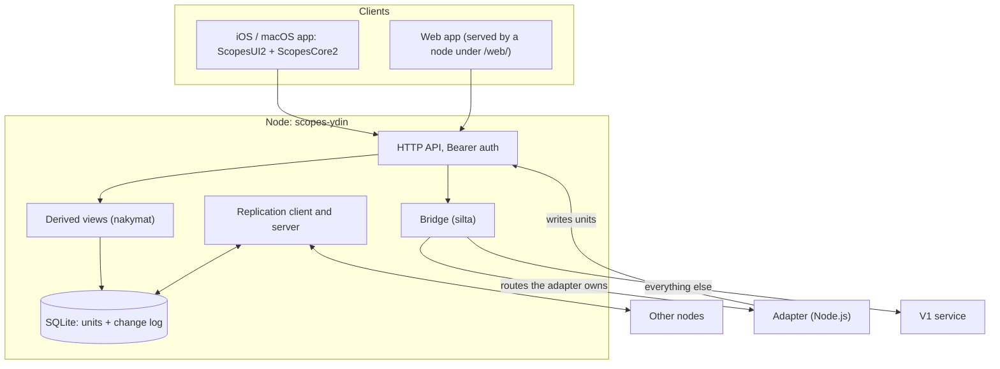

# Architecture

This document describes the parts of Scopes V2 that change slowly: the shape of the system, where things live, and the rules the code keeps. It names files and types instead of linking them. The original plan documents were kept in the private monorepo and are not here, so the reasons below are the ones recorded in code comments, tests and the registers (`REKISTERI.md`, `HISTORIA.md`). Finnish terms are explained in `docs/DEVELOPMENT.md`.

## Bird's-eye view

The problem: one developer runs dozens of Claude Code sessions in parallel ("scopes"), each with its own transcript file, usually in a tmux pane, plus helpers such as an Android phone and a Linux server. They need one view of all of it, from a phone, a Mac and a browser, including when a device is offline, and a way to send messages and commands back.

V1 answered this with a single Node service that every client called. V2 changes the shape: every client embeds a **node** (a Rust HTTP server over SQLite), nodes replicate their data to each other, and a separate **adapter** turns the outside world (transcripts, tmux, adb, usage limits) into data the nodes hold. V1 keeps running during the move; the node forwards what V2 does not answer yet.

## Codemap

**`ydin/`**: Rust crate `scopes-ydin`. One library, two binaries (`scopes-solmu`, `lr-pariteetti`), crate types `rlib` and `staticlib`.
- `yksikko.rs`: the unit model (path, id, version vector, HLC time, content, tombstone flag), the HLC, version-vector comparison, the three merge rules, and the `rekisteri` submodule that ports the register logic of V1's `lr.mjs` (splitting text into rows, ordering keys, re-import, receive, export).
- `varasto.rs`, `muutosloki.rs`: SQLite store (schema version 2), the per-node change log with a monotonically increasing `seq`, and per-peer cursors.
- `api.rs`: router assembly, Bearer middleware, `/api/terveys`, and `kirjoita_ja_ilmoita`, the single write path that also notifies the stream.
- `replikointi.rs`, `vertaiset.rs`, `virta.rs`: replication (server routes `tiiviste`, `listat`, `hae`, `laheta`; client loop per peer) and the SSE stream `/api/virta`.
- `peili.rs`, `lahde.rs`, `lahdetila.rs`, `liite.rs`: transcript mirror, per-device source state posted by the adapter, read routes over that state, and attachments.
- `nakymat.rs`: derived read models (`/api/skoopit`, messages, registers) kept in memory and updated incrementally from the change log.
- `tila.rs`: shared UI state (`/api/tila/*`). `lr.rs`: read-only peer of the V1 register service.
- `silta.rs`: the bridge to V1 and to the adapter. `web.rs`: static serving of the web app.
- `solmu.rs`: start-up shared by the binary and the FFI. `ffi.rs` plus `include/scopes_solmu.h`: the C ABI. `apple/`: XCFramework build.
- `tests/`: integration tests, mostly against real processes or in-process routers; `tests/korpus/` is the register parity corpus.

**`adapteri/`**: Node.js, no dependencies. `adapteri.mjs` (entry, polling loop plus `fs.watch`), `transkriptit.mjs` (incremental transcript reads), `peili.mjs` (mirror sender), `lahde.mjs` (source state for sessions, agy, android, usage limit, settings, queue), `toiminnot/` (action server and one module per route family), `vanhasta/` (copies of V1 modules, kept byte-identical apart from import lines), `vertailu/` (scripts that record V1 behaviour as fixtures).

**`shared/`**: `ScopesCore2` (SwiftPM; HTTP client, models, SSE and NDJSON parsing, observable stores, the node lifecycle through the XCFramework, Keychain key), `ScopesUI2` (SwiftUI views shared by both apps), `testit/` (two-device UI test, mock adapter). **`ios/`**, **`macos/`**: thin app targets generated by XcodeGen.

**`web/`**: TypeScript, built by `build.mjs` (esbuild) into `dist/`; `sw.js` is the service worker; `test/mock-ydin.mjs` is a mock node used by the tests.

**`kaynnista.sh`**: starts node and adapter, safe to call from cron.

## Invariants

- Every unit has exactly one merge rule, chosen from its path, and the rule is deterministic: the same set of units produces the same state on any node, in any arrival order.
- `seq` is local to a node. Nothing outside the change log is a source of order across nodes; cross-node order comes from version vectors and HLC.
- Every stored change is appended to the change log together with the unit. The SSE stream reads the log in `seq` order; the in-memory broadcast only wakes it, so the stream has no gaps or reordering. The shared write path is `kirjoita_ja_ilmoita`, with dedicated writers for `tila` and `peili`.
- Internal paths (`peili-offset`, `peili-karsinta`, `peili-pohja`) are never listed, hashed, sent or applied during replication.
- Absence: V2 never edits the V1 source tree, and the node never calls V1's register `laheta` route (its own `POST /api/lr/*` answer 405), never runs adb, and never writes the adapter's state files. Action routes still reach V1 through the bridge, where V1 does its own work. The adapter's runtime code imports nothing from the V1 tree; the gate script greps for that and allows one listed exception.
- Absence: the node binds `127.0.0.1` only. Everything except `/api/terveys` and `/web/*` requires the Bearer key. Keys are not logged.
- A derived read route answers from the node's own units when the adapter has published the source state, and otherwise passes the request to V1. The response header `X-Lahde` (`ydin` or `silta`) says which happened.
- Web code never uses `innerHTML`, `outerHTML`, `insertAdjacentHTML`, `document.write`, `eval` or `new Function`; the web gate fails otherwise. The service worker never caches `/api/*`.
- Only one node runs per process on Apple platforms; the FFI refuses a second start (`-4`).

## Boundaries

- **App ↔ node**: in the same process, over `127.0.0.1` HTTP with a Bearer key. The C ABI has two functions, start (JSON settings in, port and version out) and stop. Panics become `-99`. The Swift side never links Rust types.
- **Node ↔ node**: HTTP with a Bearer key. Pull-based: each node pulls from its peers' digests and stream; `laheta` is used to push at the start of a sync session and for attachments. Peer URLs are plain `http://`.
- **Adapter → node**: `POST /api/peili` (transcript lines), `POST /api/lahde/<kind>` (state), and the node's own routes for units. **Node → adapter**: only the bridge, for routes listed in the adapter's `GET /api/terveys`, using the node's key.
- **Node → V1**: the bridge forwards `GET` and `POST` of a fixed whitelist with V1's key, headers `Content-Type`, `Accept` and a few response headers, bodies unbuffered so NDJSON and SSE streams pass through.
- **Web ↔ node**: the same API as the apps; only the static shell is served without a key.

## Cross-cutting concerns

**Errors.** Rust modules use a small `Virhe(String)` with `From` conversions; HTTP errors are JSON with a `virhe` field. Status codes carry protocol meaning: 401 bad key, 409 offset mismatch (body carries the node's offset), 413 body too large, 405 for write routes on the read-only register peer, 501 `ei siirretty` from the adapter for an action route not ported yet. The FFI returns negative codes instead of unwinding.

**Testing.** Pure logic is covered by parity and unit tests (the register parity corpus has 16 cases ported from V1's test file). Protocol behaviour is tested with real `scopes-solmu` processes on OS-assigned ports (two-node convergence over 1,000 units, a `SIGSTOP` pause mid-batch, a memory ceiling). The bridge is tested against mock V1 and mock adapter servers. The apps are tested by XCUITest against a mock adapter and a test node; a two-device test runs the macOS app and an iOS simulator against each other. Behaviour of the adapter against V1 is recorded as fixtures from the old code, not written by hand.

**Observability.** `SCOPES2_MUISTILOKI=1` makes the node print memory lines that the memory test reads. The adapter logs one line per mirror send. `X-Lahde` marks provenance. `GET /api/terveys` reports `seq` on the node and the published route list on the adapter.

**Security.** One Bearer key per node, compared in constant time, stored in a `0600` file (created from `/dev/urandom` if missing) or in the Keychain on Apple platforms. No TLS in the HTTP client, so peers must be reachable over loopback or a private tunnel. Web markup is built with `createElement` and `textContent` only.

**Performance and memory.** Memory is a design input, not an afterthought. Reads are range-limited (`listaa_vali_otsakkeet` reads headers first, content only where needed), `/api/hae` returns at most 8 MiB of content per response, `/api/laheta` accepts about 400 KiB of content per request, views are incremental, the adapter runs at most 4 transcripts concurrently and caps its queue at 8 MiB. `kaynnista.sh` applies `ulimit -d` to both processes so an overrun kills one process, not the machine.

## Key design decisions

### 1. Embedded, replicating nodes instead of a server API
- **Context:** V1 is one service that every client calls. The requirements visible in V2's tests are that UI state (selection, drafts, scroll position, acknowledgements) follows the user between Mac and phone within 2 s, and that a node catches up after a peer was paused or away.
- **Decision:** every client runs the same Rust node in its own process and replicates with its peers; UI state is stored as units too (`/api/tila/*`).
- **Consequences:** apps read local data and survive a missing peer. The cost is a second language and a build step in every Apple app (XCFramework), and a replication protocol to keep correct, which is why most of the tests are about it.

### 2. One unit model, three merge rules chosen by path
- **Context:** registers need version-vector semantics ported from `lr.mjs` (concurrent edits must be kept and shown); UI state and source state are overwrite data; transcripts are append-only.
- **Decision:** a single `Yksikko` type; the rule comes from the first path segment: `Lr` for `rekisterit`, last-writer-wins by HLC (ties broken by device id) for `tila`, `asetukset`, `lahde` and `rekisterit-meta`, append-only for everything else. Concurrent `Lr` versions are stored as sibling units `<id>~<device>`.
- **Consequences:** a new data kind needs only a path prefix. The sibling scheme had a flaw: replicating a sibling under `Lr` produced siblings of siblings and never converged. The fix (brief R-2) merges any `rekisterit/*` unit with `~` in its id by LWW.

### 3. Strangler-fig bridge, with the adapter claiming routes at runtime
- **Context:** V1 serves live use and must not be edited. V2 has to be usable before it replaces everything.
- **Decision:** the node answers what it can from its units and forwards a fixed whitelist to V1. The adapter lists the routes it implements in its health response; the node polls that list (every 60 s, every 5 s while unknown) and sends matching requests to the adapter. Unported action routes answer 501. Copies of V1 modules live under `adapteri/vanhasta/` and are compared against the originals by a gate.
- **Consequences:** a route can move from V1 to the adapter without touching a client, and deployment order of node and adapter does not matter. Behaviour drift is controlled by fixtures recorded from V1, at the price of copies that need re-syncing when V1 changes (`adapteri/vertailu/V1-SYNKKA.md` lists the drift found on 2026-10-28).

### 4. Transcript mirror as append-only units keyed by file and offset
- **Context:** transcripts are large append-only JSONL files that the adapter can crash or restart while reading; sending the whole file again is not an option (the corpus was 2.4 GB across 3,476 files).
- **Decision:** the adapter sends only complete new lines. A unit is `peili/<file>:<offset>`; the sender includes `offset` and the sha256 of the exact bytes. The node rejects a wrong digest with 400 and answers 409 with its own offset when the offset differs; the adapter resumes there. The node's known offset is stored directly, outside the stream.
- **Consequences:** sending is idempotent and needs no state in the adapter beyond a bounded queue. Large units are a known gap for replication: the registers record that a unit over about 550 kB does not fit one `laheta` body, to be revisited once mirrors are replicated between nodes in earnest.

### 5. Windowed nodes and byte budgets after measuring memory
- **Context:** a production node reached 803 MB resident; the cause was loading and parsing every unit of a transcript before filtering by offset. A phone cannot hold a multi-gigabyte mirror.
- **Decision:** read keys first and content only past the offset; budget `/api/hae` by bytes with a continuation list; add a *window* option so a node keeps only recent transcript units (default on a physical iPhone: 7 days and 38 MB).
- **Consequences:** the register notes a synthetic 2.6 GB mirror going from 1,584 MiB to 98 MiB for a full node, and `muisti_taysi.rs` fails above 128 MiB on a scaled-down version. Windowed nodes drop old content, so deep history exists only on the full node.

### 6. No TLS inside the node
- **Context:** `reqwest`'s default TLS needed OpenSSL headers on the build machines (`web/gate.sh` still exports `OPENSSL_*` variables for that) and extra system frameworks in the XCFramework link step (`ydin/apple/README.md`).
- **Decision:** `reqwest` is built with `default-features = false` and without a TLS feature; the change shipped together with the cross-compile script `julkaise.sh` (zigbuild).
- **Consequences:** `Cargo.lock` contains no OpenSSL or native-tls. Transport security is delegated to the network (loopback, tunnel); the key travels in clear over any other path.
