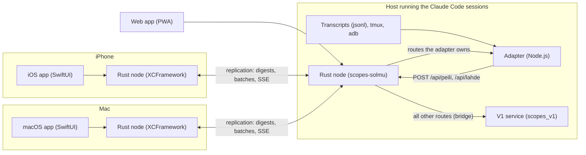

# Scopes V2

Monitoring and remote control of many parallel Claude Code sessions ("scopes") from an iPhone, a Mac or a browser, for a developer who runs a lot of agent sessions at once.

Every client embeds its own Rust node (HTTP server plus SQLite). The nodes replicate with each other, so each client reads and writes local data and there is no central database to keep up. Around the nodes sit a Node.js adapter that mirrors Claude Code transcripts into the system, a SwiftUI app for iOS and macOS, and a framework-less TypeScript web app. V2 replaces a working V1 service piece by piece instead of in one cut-over.

Names in code, file names and internal notes are Finnish; [docs/DEVELOPMENT.md](docs/DEVELOPMENT.md) has a glossary.

## What it does

- Lists every Claude Code session with its state, the next action and the open items from its register, updated live.
- Shows the chat transcript of a session and sends a message into it.
- Keeps UI state (selected session, drafts, scroll position, acknowledgements) in sync between Mac and phone; the two-device test requires an edit on one to show up on the other within 2 s.
- Remote control of an Android phone (screen view, wake, actions) and power control of a Linux server (wake, shut down).
- Opens new sessions, unpacks session hand-over packages, switches models and shows usage limits.
- Works against a stale or missing peer: the node keeps serving local data and catches up when the peer returns.

## Visual

There are no screenshots in this repository, only the architecture.



## Engineering highlights

- **Replication without a server.** Units carry a version vector and a hybrid logical clock. Three merge rules (version-vector with concurrent siblings, last-writer-wins, append-only) are picked from the unit's path. Sync is digest → list → fetch/send in batches of 300, then an SSE tail with a persisted cursor and 1–30 s backoff. [ydin/src/yksikko.rs](ydin/src/yksikko.rs), [ydin/src/replikointi.rs](ydin/src/replikointi.rs).
- **Convergence tests with real processes.** Two `scopes-solmu` processes on free ports take 1,000 units written half to each side, then a second case freezes one process with `SIGSTOP` mid-batch and checks the same end state. [ydin/tests/kaksi_solmua.rs](ydin/tests/kaksi_solmua.rs).
- **Memory as a tested property.** A production node once reached 803 MB resident because reading a transcript loaded every unit before filtering by offset. The fix lists ids first and loads content only past the offset; `/api/hae` has a byte budget; the iPhone node keeps a windowed mirror (7 days, 38 MB by default on a physical device). A regression test asserts a peak below 128 MiB. [ydin/tests/muisti_taysi.rs](ydin/tests/muisti_taysi.rs), [ydin/src/peili.rs](ydin/src/peili.rs).
- **Idempotent transcript mirroring.** The adapter sends only complete new lines with `offset` and a sha256 of the exact bytes; the node rejects a bad digest with 400 and answers 409 with its own offset when the offset differs, and the adapter resumes from there. Batches stay under the node's 2 MB body limit and the in-memory queue is capped at 8 MiB. [adapteri/peili.mjs](adapteri/peili.mjs).
- **Strangler-fig bridge.** The node forwards a whitelist of routes to the V1 service, streams included. The adapter publishes the routes it has taken over; the node polls that list and sends those to the adapter, so a route moves without a client change. [ydin/src/silta.rs](ydin/src/silta.rs).
- **A Rust node inside an iOS app.** The crate builds as a C-ABI static library packaged as an XCFramework for iOS, simulator and macOS. Every FFI entry catches panics and returns a negative code. [ydin/src/ffi.rs](ydin/src/ffi.rs), [ydin/apple/rakenna-xcframework.sh](ydin/apple/rakenna-xcframework.sh).
- **Behaviour parity with the JavaScript original.** The register logic was ported from V1's `lr.mjs`; its 16 test cases are a JSON corpus replayed against the Rust module, and a script compares both implementations on a sample of real registers. [ydin/tests/lr_pariteetti.rs](ydin/tests/lr_pariteetti.rs).
- **Web client without a framework or `innerHTML`.** The gate script fails the build on `innerHTML`, `eval` and friends. SSE runs over `fetch` because `EventSource` cannot send an `Authorization` header. [web/src/virta.ts](web/src/virta.ts), [web/gate.sh](web/gate.sh).

## Tech stack

| Layer | Technology | Version |
|---|---|---|
| Node | Rust, axum, tokio, rusqlite (bundled SQLite), clap | edition 2021; axum 0.7.9, tokio 1.53.3, rusqlite 0.32.1 (Cargo.lock); needs rustc 1.88+ |
| Apple glue | C ABI, XCFramework, SwiftPM (ScopesCore2, ScopesUI2) | swift-tools 5.9; iOS 18.0, macOS 14 |
| Apps | SwiftUI, XcodeGen projects | XcodeGen config in `ios/project.yml`, `macos/project.yml` |
| Adapter | Node.js (ES modules, `node:sqlite`, `node:test`) | Node 22 or newer |
| Web | TypeScript, esbuild, PWA with service worker, Playwright (browser tests) | typescript 5.9.3, esbuild 0.25.12, playwright-core 1.63.0 |
| Launcher | Bash, `flock` | Linux only |

## Architecture

Each node owns a SQLite store of *units* (path, id, version vector, HLC timestamp, content) and an ordered change log. HTTP routes, the SSE stream, the views for the apps and the replication all read that log. Clients never talk to Claude Code directly: the adapter turns transcripts, tmux panes and adb state into units, and the apps read derived views of them. Routes the node cannot answer yet from its own units fall through to V1.

Layers, invariants and the main design decisions are in [ARCHITECTURE.md](ARCHITECTURE.md).

## Repository layout

```
ydin/        Rust crate scopes-ydin: node binary scopes-solmu, C-ABI library, tests, gate.sh
  apple/       XCFramework build script
adapteri/    Node.js adapter: transcript mirror, source state, action server, V1 copies (vanhasta/)
shared/      SwiftPM packages ScopesCore2 (client, models, sync) and ScopesUI2 (SwiftUI views), shared UI tests
ios/         iPhone app (XcodeGen project, UI tests, install script)
macos/       Mac app (XcodeGen project, UI tests)
web/         TypeScript PWA, built with esbuild, served by the node under /web/
kaynnista.sh Idempotent launcher (cron-safe, flock) for node and adapter, Linux
docs/        DEVELOPMENT.md: how the project was built, file map, glossary
```

Each component directory also holds `REKISTERI.md`, `HISTORIA.md` and `ARKISTO.md`, the working notes described in [docs/DEVELOPMENT.md](docs/DEVELOPMENT.md).

## Getting started

Prerequisites: Rust 1.88 or newer, Node 22 or newer. For the Apple apps additionally a Mac with Xcode (iOS 18 and macOS 14 SDKs), XcodeGen, and `rustup target add aarch64-apple-ios aarch64-apple-ios-sim aarch64-apple-darwin`.

Node and tests:

```sh
cd ydin
cargo build --release
cargo test
cargo run --release --bin scopes-solmu -- --help     # default: 127.0.0.1:8797, key file created on first start
```

Web client against the real node (`--web` serves it under `/web/`):

```sh
cd web && npm ci && node build.mjs
cd ../ydin && cargo run --release --bin scopes-solmu -- --web ../web/dist
```

Web client against a mock node, no Rust needed:

```sh
cd web && node test/mock-ydin.mjs --portti 18796 --dist dist
```

Apple apps:

```sh
cd ydin && bash apple/rakenna-xcframework.sh      # builds ScopesSolmu.xcframework for three targets
cd ../ios && xcodegen                              # then open ScopesV2.xcodeproj
```

Set `DEVELOPMENT_TEAM` in `ios/project.yml` (it contains the placeholder `YOUR_TEAM_ID`; bundle ids use `com.example`). The app starts its own node. The peer address defaults to `http://127.0.0.1:18797`; override it with the environment variable `SCOPES2_VERTAINEN` ([Solmu.swift](shared/ScopesCore2/Sources/ScopesCore2/Solmu.swift)) or the UserDefaults key `scopes2.vertainen` ([iOS](ios/Sources/ScopesV2App.swift), [macOS](macos/Sources/SolmunElinkaari.swift)).

What the system needs beyond this repository: a running V1 service for any bridged route, and the Claude Code sessions, tmux and adb that the adapter observes. Without them the node starts and the apps show fixture data or an empty state. The adapter is started by [kaynnista.sh](kaynnista.sh) or directly with `node adapteri/adapteri.mjs`; its flags are documented in the header of [adapteri/adapteri.mjs](adapteri/adapteri.mjs).

## Tests

Rust and web counts are from real runs; the Swift and adapter counts are from grepping the test attributes (see limitations).

| Suite | Count | Notes |
|---|---|---|
| Rust (`ydin/tests`, 28 files) | 195 | `cargo test --release --no-fail-fast` on aarch64 Linux, rustc 1.99.1 (29.10.2026): 193 passed, 1 failed, 1 `#[ignore]` helper. Includes two-process convergence, SIGSTOP, memory gate, FFI, bridge, 16 parity cases. See limitations for the failure |
| Swift package tests | 124 | ScopesCore2 108, ScopesUI2 16; `swift test` needs the XCFramework built first |
| Swift UI tests | 38 | iOS 16, macOS 12, shared two-device 10; need a simulator or device, a running test node, and a free screen |
| Node (adapter) | about 230 | `node --test <file>`; 19 files, of which only 4 pass fully in a standalone checkout, see below |
| Web | 55 | `node --test test/*.test.ts` after `npm ci`; passes (55/55) in a clean checkout. Browser smoke tests (`savu*.ts`, `hyvaksynta*.ts`) need Chromium |

## How it was built

Mikko Paaso set the requirements, designed the architecture and directed the work. Claude Code agents wrote the code from written briefs, and tests plus runs on real devices were the acceptance gates. Mikko reviewed the results and decided what to keep.

- The work ran in a supervised loop: a planner wrote a brief per task (files the agent may and may not touch, the interface contract, steps, the exact acceptance commands, a six-line report format and a token budget), an executor agent implemented it, and a gate script decided pass or fail. Example briefs: [ydin/briefit/](ydin/briefit/).
- Gate scripts snapshot the working tree before a run and fail if anything outside the task's allowed paths changed, and a V1 tree fence stops accidental edits to the old service.
- Each component keeps a register of open items, decisions and faults, a change history and an archive. Several faults in the registers are the agents' own mistakes, recorded the same day.
- Evidence in git: 82 commits between 2026-10-19 and 2026-10-29 (five active days), 57 distinct task ids in commit subjects (`T-16` … `T-108`), and 76 commits with a `Co-Authored-By` trailer (57 Claude Opus 5.5, 19 Claude Sonnet 5.5).
- The briefs for most tasks lived in the private monorepo and are not included; the registers refer to them by id.

Details and a glossary of the Finnish terms are in [docs/DEVELOPMENT.md](docs/DEVELOPMENT.md).

## Status and limitations

- Extracted from a private monorepo. The `gate.sh` scripts, `kaynnista.sh`, `ydin/julkaise.sh` and the install script expect the original development environment (paths, an ssh alias for the host, Node under a fixed home directory, Mac build locks). Many file headers and notes still use the old monorepo prefix `scopes2/`.
- The adapter's tests import tooling from outside this repository (`claude/siirto/tools/asetus-tila.mjs`); without it most of the 19 adapter test files fail at import (14 fail on macOS in this checkout; 4 pass fully, 1 passes 9 of 10; `kuorma.test.mjs` also reads Linux `/proc`). `ydin/pariteetti.mjs`, `ydin/lr-pariteetti.mjs` and `adapteri/vertailu/` need the V1 repository next to this one (`../../scopes/...`).
- `kaynnista.sh` is Linux-only (`/proc`, `flock`). `ydin/julkaise.sh` cross-compiles for Linux aarch64 from a Mac.
- Rust suite, run on 29.10.2026: `muisti_taysi` fails deterministically on its byte-exact snapshot of the `/viestit` replies (`VERTAILU`, recorded before task T-76). The node code has changed since and the snapshot was not re-recorded; the memory limit the test is named for holds (peak 54 MiB < 128 MiB). `kaksi_solmua_ikkuna` is timing-sensitive on a loaded host: it failed once in three runs and passed alone. The Swift suites were not re-run for this documentation. The web suite and the adapter files that do not need external tooling were run.
- UI tests, the two-device test and the install script need a Mac, a simulator or an iPhone, and real Claude Code sessions for a meaningful result. No screenshots exist.
- The HTTP client is built without TLS. Peer links are plain `http://` with a Bearer key, so keep them on loopback or a private tunnel.
- `shared/ScopesCore2/Package.swift` still links `SystemConfiguration` and `libresolv`, left over from when the Rust side used native TLS. Whether they are still needed is not verified.
- Test fixtures were synthesised from real shapes; a few still contain path-like strings from the original machine.

## Related repositories

- [scopes_v1](https://github.com/Rolppe/scopes_v1): the V1 Node service and iOS app that V2 replaces. V2 bridges to it and copies some of its modules (`adapteri/vanhasta/`).

## License

AGPL-3.0-only, see [LICENSE](LICENSE). Copyright (c) 2026 Mikko Paaso.
